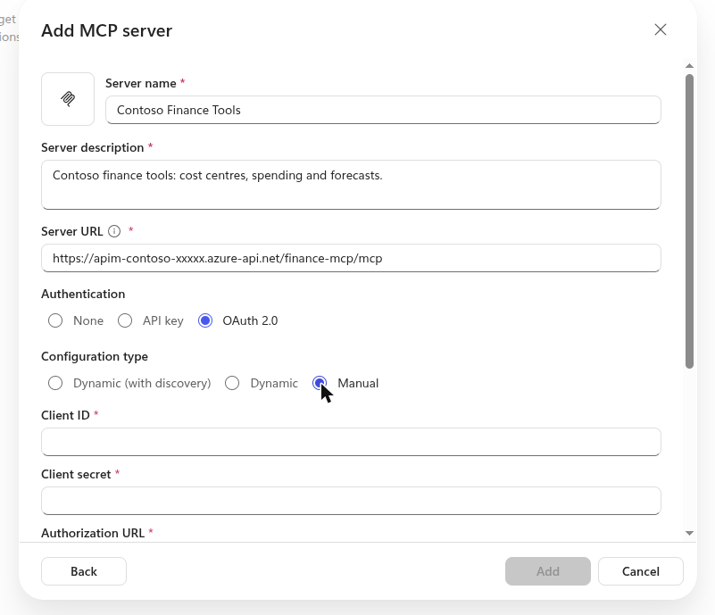
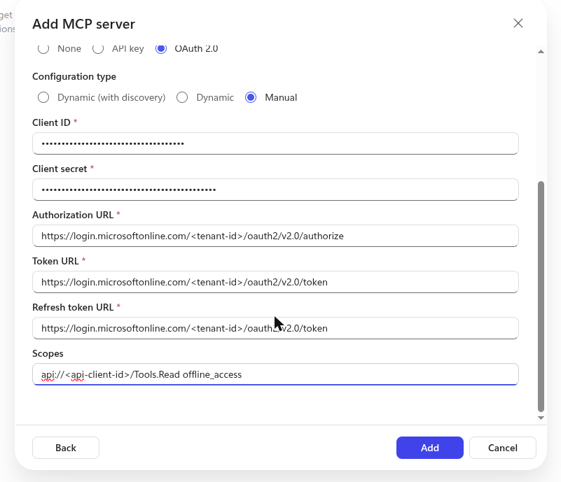
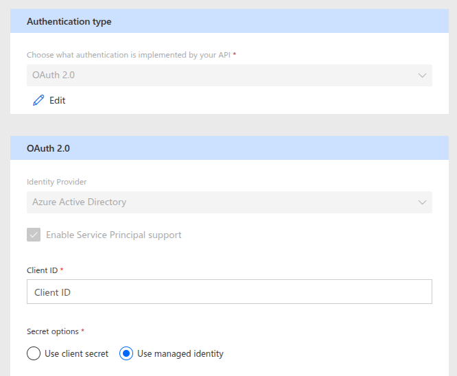
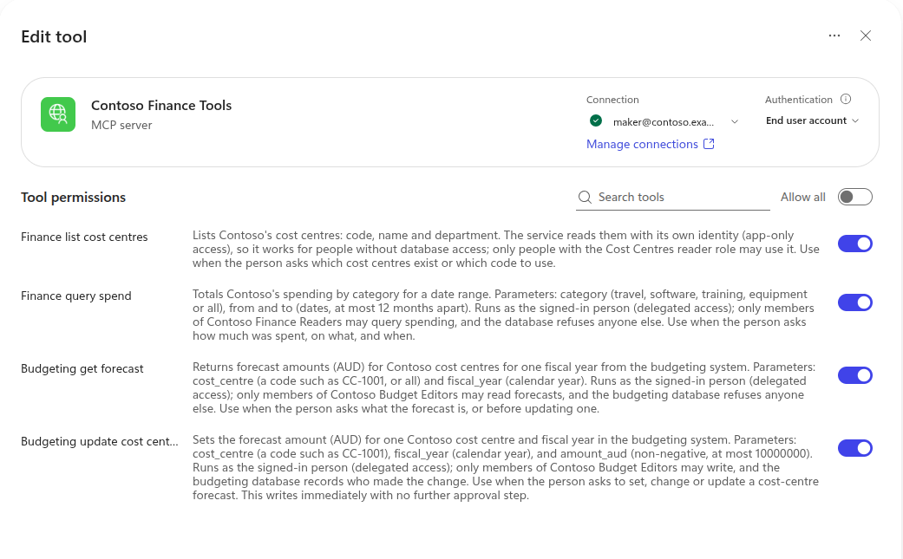
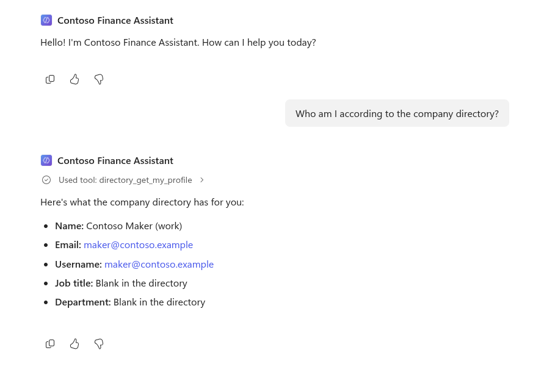

# Connect a Copilot Studio agent to its MCP server

The maker's steps in Copilot Studio and Power Apps to wire an agent to an MCP server with **no client
secret**: a managed identity and a federated identity credential. An agent uses one MCP server for each
business domain it needs (the Finance Assistant uses `directory` and `finance`), so repeat steps 2 to 5
once for each server, always with the agent's own client ID. The full order of operations, from
Terraform to the first test, is in [Stand up the stack](deploy.md#stand-up-the-stack); this page covers
steps 4 to 7 there. For vocabulary see [concepts.md](concepts.md).

**Before you start**, finish [the prerequisites](deploy.md#prerequisites) and steps 1 to 3 of the
stand-up, and sign in to Copilot Studio with a **work** account. On the secure profile the enterprise
policy must be linked and the VPN up. The rapid profile's gateway is public.

**Harness.** The steps use the **Microsoft Copilot harness** (Home → **Agent**), which needs a Sandbox
with pay-as-you-go, or Preview returns `EnforcementUsageCredits`. The connector and Terraform steps
are identical on the Standard harness; the portal paths differ ([appendix](#appendix-standard-harness)).
The screenshots come from the Standard builder; on the Microsoft Copilot harness use **Tools → Add tool**
on the single editor page. The field names match.

## Who does what

| Step | How |
|---|---|
| Delegated subnets in both regions, peering, DNS, the `NetworkInjection` enterprise policy (secure profile) | Terraform ([network/powerplatform.tf](../infra/modules/contoso-gateway/network/powerplatform.tf)) |
| The Power Platform environment (**Sandbox**; Australia; Dataverse), data-residency settings, Managed Environment with agent sharing limits | Terraform ([powerplatform.tf](../infra/modules/contoso-gateway/powerplatform.tf)); with a billing plan, create in the admin center and import ([AGENTS.md](../AGENTS.md)). Never Developer: it can't take pay-as-you-go, which the Microsoft Copilot harness needs |
| **Linking the policy to the environment** (secure) | Terraform (`powerplatform_enterprise_policy`) |
| Creating the agent, adding the MCP server, switching its connector to a managed identity | By a maker in Copilot Studio and Power Apps (this page). Can also be kept as code with the Copilot Studio extension for VS Code |
| The connector's callback URL and federated identity credential on the agent's app registration | Terraform, from values the maker copies (`copilot_connectors`) |
| Creating the connection | Each user, in Power Apps Connections (step 5), by signing in |

The maker needs **no Entra admin roles**: Terraform does the admin work, and the maker is the
environment's owner.

## Values you need

Get them from Terraform. None of them are secrets.

```bash
P=infra/profiles/rapid   # or secure
terraform -chdir=$P output -json agents   # client ID, and the URL of each server, per agent
terraform -chdir=$P output -raw tenant_id
terraform -chdir=$P output -raw api_client_id
```

| Field | Value |
|---|---|
| Server URL | `agents.<agent>.servers.<server>`, for example `https://apim-contoso-xxxxx.azure-api.net/finance-mcp/mcp` |
| Client ID | `agents.<agent>.client_id`, the agent's own app registration |
| Authorization URL | `https://login.microsoftonline.com/<tenant_id>/oauth2/v2.0/authorize` |
| Token URL and Refresh URL | `https://login.microsoftonline.com/<tenant_id>/oauth2/v2.0/token` |
| Scopes | `api://<api_client_id>/Tools.Read offline_access` |

Use **the agent's own** client ID. API Management identifies the agent by it (the token's `azp`
claim), so a connector configured with the client ID of an agent that doesn't use the server is **refused (401)** by that server (tested: [testing.md](testing.md)).

## Before step 1: get a role in the environment

A new Sandbox gives the maker no role in it, and Copilot Studio then quietly opens the Default
environment instead of the one you picked. In the Power Platform admin center open the environment and
choose **Membership → Add me** (a tenant administrator can add themselves to the System Administrator
role). The change took effect within a few minutes. The new Copilot Studio has no environment picker:
open **More → Open classic experience** and use the picker there, or follow the environment's own URL
once you have a role.

## Step 1: Create the agent

1. In [Copilot Studio](https://copilotstudio.microsoft.com), select the environment (bottom left).
   Don't use the Default environment: on the secure profile it can't reach the private network.
2. Select **Home → Agent**. On a new Sandbox you may need **Get role** (System Administrator) first.
3. Name the agent and **Save** (Ctrl+S) until the page URL contains a bot ID. Naming it on
   `/agents/new` alone doesn't persist.

## Step 2: Add an MCP server

1. Open **Tools** → **Add a tool** → under *Create new*, **Model Context Protocol**.

   If the name is **already in use**, the Add button stays disabled ("Choose a different server
   name"). Cancel and pick the existing connector from the tool picker instead, but only once its
   managed identity and Terraform trust (steps 3 and 4) are done. Create a connector here only when
   the environment has none yet.

   
2. Fill in:
   - **Server name**: a short name, for example `Contoso Finance Tools`.
   - **Server description**: what the tools do and when to use them. **The orchestrator reads this
     to decide whether to call the server**, so describe the tools, not the infrastructure.
   - **Server URL**: the agent's MCP URL.
3. **Authentication: OAuth 2.0 → Manual.** (Microsoft Entra ID doesn't support dynamic client
   registration, so *Dynamic discovery* doesn't work.)
4. Fill in the client ID, URLs and scopes from the table above. For **Client secret**, enter any
   placeholder text, for example `placeholder-replaced-by-federated-credential`. The wizard requires
   a value, and the next step replaces it with a managed identity. Scope is space-separated
   (`…/Tools.Read offline_access`), not comma-separated.

   
5. Select **Create** / **Add**. Copy the **Redirect URL** it shows, which looks like
   `https://global.consent.azure-apim.net/redirect/<connector-name>-<id>`.

6. **Cancel this dialog** (the tool and its connector are already saved) and continue in Power Apps.
   Don't create the connection from this dialog: it keeps the connector definition from before
   step 3, and connecting fails with `ParameterNotDefined: Parameter 'token' is not allowed`. If you
   do sign in too early against a redirect not yet on the app registration, Entra returns
   `AADSTS50011`.

## Step 3: Switch the connector to a managed identity

1. Open [Power Apps](https://make.powerapps.com) in the same environment → **Custom connectors**. The
   wizard created a connector with your server name. Select its **edit** (pencil) icon.
2. Go to **2. Security** and select **Edit**.
3. Set **Identity Provider** to **Azure Active Directory**, and leave **Enable Service Principal
   support** ticked.
4. Under **Secret options**, select **Use managed identity**.
5. Set:
   - **Tenant ID**: your tenant ID (not `common`).
   - **Resource URL**: `api://<api_client_id>`.
   - **Enable on-behalf-of login**: `false`. Users sign in once in the chat; the `true` option is
     for single sign-on and needs extra app registration setup.
   - **Scope**: `api://<api_client_id>/Tools.Read offline_access`.
6. Select **Update connector**. The **Managed identity** box now shows the federated identity credential's
   **Issuer** and **Subject**. Copy them with the copy button (the box is too narrow to read them;
   the connector's **View properties** page shows more, but still truncates the subject).
   The **Client ID** field may now appear empty; that's how the managed identity mode displays it,
   and the connection still works.

   To read the issuer and subject exactly, without the copy button, ask the Power Platform admin API
   (it returns the connector's federated identity credential in full):

   ```bash
   az rest --resource https://service.powerapps.com/ --method get \
     --url "https://api.powerapps.com/providers/Microsoft.PowerApps/scopes/admin/environments/<environment id>/apis?api-version=2016-11-01&\$filter=IsCustomApi eq true"
   ```



## Step 4: Trust the connector in Entra ID (Terraform)

Add the values to `infra/profiles/<profile>/terraform.tfvars`. Copy
[terraform.tfvars.example](../infra/profiles/secure/terraform.tfvars.example) if the file doesn't exist.
It's git-ignored because it names your tenant and users; none of the values are secrets.

```hcl
copilot_connectors = {
  "<connector name>" = {            # last path segment of the redirect URL, e.g. new-5fcontoso-20finance-20tools-5f…
    agent        = "finance-assistant"
    redirect_uri = "<Redirect URL from step 2>"
    subject      = "<Subject from step 3>"
  }
}
```

The issuer isn't needed: it's always `https://login.microsoftonline.com/<tenant>/v2.0`, which
Terraform builds. One entry per connector, so an agent with two servers has two entries.

Then plan to a file, read it, and apply that file (`terraform -chdir=infra/profiles/<profile> plan -out=...`,
then `apply`). Expect the agent's app registration to change plus, when the connector key changed, a
federated identity credential destroyed and created and a swap of the connector ID in the data policy;
cosmetic policy differences are normal ([AGENTS.md](../AGENTS.md)). The apply adds:

- the **redirect URL**, so Entra ID returns users to Copilot Studio after sign-in;
- a **federated identity credential**, so Entra ID accepts the connector's managed identity in place
  of a secret.

## Step 5: Connect and test

1. In Power Apps → **Connections** (same environment). Use the **list** search box (not the global
   Power Apps search in the header). Find your server name → **New connection** / **+** → leave
   **OAuth Connection** selected → **Create**. A Microsoft popup asks you to pick the **work**
   account (and, the first time for an agent's app, to consent). Clicking the already-signed-in
   work account is usually enough; if a password or MFA page appears, the user must complete it. The
   connection must show **Connected** (not Reconnect). An older failed attempt may sit beside it as
   Reconnect; leave it and use the Connected one.
2. In Copilot Studio, open the agent → **Tools** → **Add a tool** → filter **Model Context
   Protocol** (or search the name) → select your server. The Connected connection is selected.
   Select **Add** / **Add and configure**.
3. Under **Tools**, the server's tools are listed. **They should be exactly that agent's tools**
   from the servers it uses. If it shows "Connector request failed" straight after adding, select the
   refresh icon: the first listing can fail while the new connection propagates. The
   **Resources** section always shows an error: API Management MCP servers expose tools, not MCP
   resources.

   The Finance Assistant lists `directory_get_my_profile`, `finance_list_cost_centres`, `finance_query_spend`, `budgeting_get_forecast` and
   `budgeting_update_cost_centre_forecast`; the Employee Assistant lists
   `directory_get_my_profile` only.

   The two screenshots below show earlier tool names (`hello`, `whoami`, `sqlwhoami`); the screens and
   the steps are the same.

   
4. In **Preview** (Copilot harness) or the **Test your agent** pane (Standard), ask something that
   needs a tool, for example *"Who am I according to the company directory?"*, *"What is the FY2026
   forecast for cost centre CC-1001?"*, then *"Update the FY2026 forecast for CC-1001 to AUD 450000."*
   Confirm the activity / "Used tool" line names the expected tool. Then try the rest of the
   demonstration ([README](../README.md#the-demonstration)).

   

## What to expect

- Each server lists exactly the tools of its entry in `server_definitions`; across its servers, the agent sees its own tools.
- Delegated tools run as whoever is chatting, via OBO. Someone outside Contoso Finance Readers is
  refused by the database when they ask about spending, while the cost centres (app-only) still work
  for anyone with the app role.
- The first chat after creating a connection may ask the user to verify it ("Open connection
  manager"); it already shows Connected, so start a new test session and ask again.
- Publishing needs a channel (only Microsoft 365 and Teams is allowed by the data policy) and, on a
  trial, a Sandbox environment with a billing plan: see [deploy.md](deploy.md#which-harness-and-copilot-credits).
- Only the connector's **API calls** use the virtual network. Its **OAuth calls** go to Entra over the
  internet, which is fine because Entra is public anyway.
- Power Platform data policies can block the connector (and so the MCP server) per environment.

## Troubleshooting

| Symptom | Likely cause |
|---|---|
| Tools page says "Upgrade your license to start using tools" | No Copilot Studio licence or trial for this user |
| `ParameterNotDefined: Parameter 'token' is not allowed on the connection` | You created the connection from the wizard dialog after changing the connector's security. Create it in Power Apps instead (step 5) |
| "Connector request failed" with `[{"jsonrpc":"2.0"}]` right after adding | The first listing after creating the connection; select refresh |
| Adding the server times out, or the connection can't list tools | The enterprise policy isn't linked yet, or linked under 30 minutes ago; or a delegated subnet can't resolve or reach API Management |
| Sign-in error mentioning the redirect URI (`AADSTS50011`) | Step 4 not applied, wrong redirect copied, or `copilot_connectors` still has a **previous environment's** connector name |
| Sign-in error `AADSTS70025` ("no configured federated identity credentials") or another `AADSTS7002xx` | The credential is missing, or its subject doesn't match the connector exactly (step 4) |
| MCP **Add** button disabled; "Choose a different server name" | The connector already exists: pick it from the tool list instead of creating it again |
| A connection stays on "Signing in" or ends in an error | A new connection opens a Microsoft sign-in popup on the user's desktop, which has to be completed. Deleting the pending connection too early removes the popup. A retry once failed with `ParameterNotDefined: Parameter 'token' is not allowed` and then worked after the connector page was opened and closed; the cause was not found |
| Preview: `EnforcementUsageCredits` / "out of credits" | The environment is a Developer one, or has no pay-as-you-go plan or credits. Use a Sandbox with a billing plan |
| Custom connectors page looks empty in automation | List is inside a Power Automate iframe; interact with that frame |
| Chat answers "from knowledge" instead of calling the tool; `Connector request failed … badRequest` on `initialize` in the activity map; nothing reaches API Management | **The connection has gone to "Reconnect"** (Power Apps → Connections), hours after it worked. Neither *Reconnect* nor *Switch account* did anything here. What worked: **delete the connection and create a new one** (step 5), then in the chat select **Allow** on the "Connect to continue" card. In production, expect to repeat this for each user; it is the weakest point of the connector-based design |
| `DataLossPreventionViolation` in the chat | The agent uses a connector or knowledge source the environment's data policy blocks (anything other than this API Management's MCP servers, Teams and Application Insights). Remove it, or change [governance.tf](../infra/modules/contoso-gateway/governance.tf) through review |
| Tool calls return 401 | The client ID belongs to a different agent than the MCP server URL |
| Tool calls return 403 | The tool isn't on a server this agent uses, so it isn't on the agent's allow-list |

## Appendix: Standard harness

Create the agent from Home → **Other ways to build → Agent (Standard)** → **Create**, and wait for
"Your agent has been provisioned". Tools live under the **Tools** tab; test in **Test your agent**.
Steps 2 to 5 (MCP server, managed identity, Terraform, connection) are identical. The Standard harness
can exercise tools in the test pane without Copilot Credits; publishing still needs a Sandbox with
pay-as-you-go ([deploy.md](deploy.md#which-harness-and-copilot-credits)).

## Learn more

- [Connect your agent to an existing MCP server](https://learn.microsoft.com/microsoft-copilot-studio/mcp-add-existing-server-to-agent)
- [Use Microsoft MCP Server for Enterprise from Copilot Studio](https://learn.microsoft.com/graph/mcp-server/use-enterprise-mcp-server-copilot-studio) (the same managed identity and federated identity credential steps)
- [Workload identity federation](https://learn.microsoft.com/entra/workload-id/workload-identity-federation)
