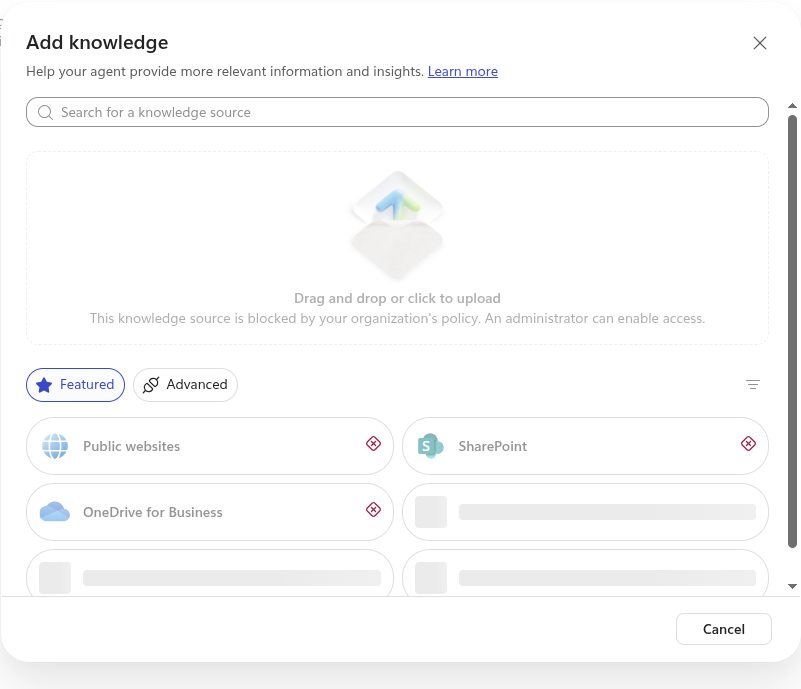

# Governance

Who decides what an agent may do, where that decision is recorded, how it is enforced, and how it is
reversed. Security controls are in [security.md](security.md); this page is about ownership, approval
and change.

Status marks are the same as in [security.md](security.md): ✅ built and tested, 🔲 built or configured
but not tested here, ⏳ not built.

## The decisions, and who owns them

Each grant has one place where it is made and one mechanism that enforces it. None relies on the
agent's instructions.

| Decision | Made in | Enforced by | Owner | Status |
|---|---|---|---|---|
| **Which tools an agent has** | `server_definitions` and `agent_definitions` in [main.tf](../infra/modules/contoso-gateway/main.tf), a reviewed change | The MCP servers the agent uses (what it lists) and the API policy's allow-list (what it may call) | Platform team, with the system's owner | ✅ |
| **Which users may use an app-only tool** | An app role assignment in Terraform (`cost_centres_user_upns`) | The API policy, which requires the role on the user's token | The data owner | ✅ |
| **Which users may read a system's data through a delegated tool** | The source system's own permissions. Here, membership of the Contoso Finance Readers group | The source system. Here, Azure SQL | The data owner, as today | ✅ |
| **Which connectors, MCP servers and knowledge sources an agent may use** | The environment's data policy ([governance.tf](../infra/modules/contoso-gateway/governance.tf)) | Power Platform | Power Platform administrator | ✅ |
| **Who an agent may be shared with** | Managed Environment settings ([powerplatform.tf](../infra/modules/contoso-gateway/powerplatform.tf)) | Power Platform | Power Platform administrator | 🔲 |
| **Where data is processed** | Environment settings and Azure regions | Power Platform and Azure | Power Platform administrator | ✅ / 🔲 |
| **Whose credentials a tool runs with** | End-user credentials (the default) or the maker's | Power Platform admin center | Power Platform administrator | ⏳ Not enforced |

**Granting a tool to an agent is an access grant.** It lets that agent read that data on behalf of any
user who uses it. It is one line in Terraform, so it can be reviewed, approved and audited like any
other permission change. The MCP servers and the allow-list are generated from the same line, so what
an agent is shown and what it is allowed can't disagree.

## The data policy

A data policy decides which connectors may be used in an environment. In Copilot Studio an MCP server
is a connector, so **a data policy can block an MCP server**.

The agents' environment has an allow-list, not a block-list:

| Group | What is in it | Effect |
|---|---|---|
| Business | Custom connectors whose host is this gateway; the Microsoft Teams channel; Application Insights in Copilot Studio | Allowed, and may be used together |
| Non-business | The connectors Microsoft doesn't allow to be blocked | Can't be combined with Business connectors in one agent |
| Blocked (the default) | Everything else, including other custom connectors, third-party MCP servers, public-website knowledge, unauthenticated chat, and connectors Microsoft adds later | Refused |

✅ Tested: adding a public website as knowledge made the agent refuse the whole turn with
`DataLossPreventionViolation`.

Three behaviours found by testing:

- **The policy must name a connector by its full ID** (`/providers/Microsoft.PowerApps/apis/shared_...`).
  With the bare name, the policy appears to work but connections to that connector stay blocked.
- **Triggers need the Microsoft Copilot Studio connector allowed.** Without it, an agent's Triggers
  section reports that the policy blocks every trigger type. The `allow_agent_triggers` setting does
  this.
- **A publish can fail with a blocked connector that the message doesn't name.** Read the policy, not
  the error.
- **A workflow's Agent node needs the Microsoft "Agents" connector.** The allow-list blocks it, and
  creating the node's connection fails with a data policy message
  ([screenshot](images/governance/dlp-agent-connector-blocked.png)). The `allow_workflow_agents` variable
  (default false) adds the connector (`shared_agentnode`) to the Business group. The connection dialog kept
  reporting the block for about 40 minutes after the policy listed the connector, so this was not
  propagation delay. The connector doesn't appear in the Power Apps connections catalogue, so it can't be
  created there instead. The cause is not found. The policy then has to allow that
  connector deliberately, which is a decision for the platform owner.

## Managed Environment

A Managed Environment is required for Power Platform Virtual Network support, and it carries the
sharing limits:

| Setting | Value | Status |
|---|---|---|
| Agents may be shared with | At most 10 named users, never whole security groups | 🔲 Configured; not tested with a second user |
| Generative AI may move data across regions | Off | ✅ Set; maker-side features show "Feature blocked by your environment" |
| Bing search | Off | ✅ Set |

## Data residency (Australia)

| Control | Where | Effect |
|---|---|---|
| Environment in the **Australia** geography | The Power Platform environment | Dataverse (agent definitions, transcripts) is stored in Australia |
| **Move data across regions: off** | Environment setting | Generative AI runs on in-region model capacity; features with no in-region capacity are switched off, not sent abroad |
| **Bing search: off** | Environment setting | No web grounding |
| The data policy blocks public-website knowledge | [governance.tf](../infra/modules/contoso-gateway/governance.tf) | A maker can't bring web grounding back for one agent |
| Azure resources in Australia East and Australia Southeast | Terraform | API Management, the backend API, Azure SQL and logs stay in Australia |

**What a maker sees:** some authoring assistance in Copilot Studio shows *"Feature blocked by your
environment"*. That is this setting refusing to send data outside Australia. The agents' answers and
tool calls were unaffected.

**Choose the model deliberately.** 🔲 Which models stay available with data movement off was not
validated, only that the default orchestration works. Microsoft says the default models run in-region,
while some newer or third-party models are cross-geography and are unavailable, or must be explicitly
allowed, when data movement is off. See
[Move data across regions](https://learn.microsoft.com/power-platform/admin/geographical-availability-copilot)
and [Data locations in Copilot Studio](https://learn.microsoft.com/microsoft-copilot-studio/data-location).

## Stopping an agent, and revoking access

Know how fast each lever works before you need it. Timings marked ✅ were measured; those marked 🔲 are expectations from Microsoft's documentation.

| Lever | Effect | Speed |
|---|---|---|
| Remove the agent from `agent_definitions`, or a tool from its server, and apply | The gateway refuses it; the tool disappears from the agent's list | About 95 seconds to apply, then immediate ✅ |
| Remove the source system's grant (here, the database user for a group or for the backend API's identity) | The system refuses the next call | Immediate ✅ |
| Remove a user's app role | A token issued before the removal keeps working until it refreshes; a fresh token is refused | Up to the token's lifetime ✅ |
| Remove a user from the group a system trusts | Takes effect when the user's token is next issued | At next sign-in 🔲 |
| Block the connector in the data policy | The agent can't use it | Minutes 🔲 |
| Disable the agent's client app | New tokens can't be issued; tokens already issued last until they expire | Minutes 🔲 |
| Delete the connector's federated identity credential | **New** connections and refreshes fail (`AADSTS70025`); existing connections work until their token expires | Not a kill switch on its own ✅ |
| Change a network security group rule | Applies to new connections only. Power Platform reuses warm ones, so a running agent wasn't affected for at least two minutes | **Not a kill switch** ✅ |

**The fast, certain levers are the allow-list and the source system's own grant.** Token-based
entitlements (app roles, group membership) lag by a token lifetime, and network changes don't cut
existing connections.

A removed tool doesn't look like a block to the user. The agent says it can't help, or answers from
general knowledge, with no error ([ai-safety.md](ai-safety.md#silent-failure)).

## The agent lifecycle

| Stage | What governs it | Status |
|---|---|---|
| **Build** | A maker builds in the environment. The data policy limits what can be added. The maker needs no Microsoft Entra administrator role | ✅ |
| **Connect** | The maker creates the MCP connector; the platform team trusts it by adding its federated identity credential in Terraform ([add-mcp-tool-to-agent.md](add-mcp-tool-to-agent.md)). An untrusted connector can't sign anyone in | ✅ |
| **Publish** | Needs at least one channel; only Microsoft Teams and Microsoft 365 is allowed by the data policy. On a trial tenant it also needs a Sandbox or Production environment with a billing plan | ✅ Published, with a scheduled trigger (Standard harness) |
| **Run** | Every tool call passes the gateway: allow-list, role, parameters, rate limit, audit trace | ✅ |
| **Change** | A Terraform plan for the server and agent maps; the smoke test afterwards | ✅ Mechanism. ⏳ No approval workflow |
| **Promote** (development to test to production) | A connector exported to another environment gets a **new managed identity**, so each environment needs its own federated identity credential | ⏳ One environment only |
| **Retire** | Remove the agent from `agent_definitions`; delete it in Copilot Studio | 🔲 |

## Licences are part of the control set

Power Platform Virtual Network support requires an E5-class licence for every user of the environment.
If those licences lapse, the private path stops working. Treat licence expiry as an operational risk to
a security control, and monitor it.

## Review cadence (suggested)

- **Weekly:** the denial and throttling queries ([observability.md](observability.md)).
- **Monthly:** each agent's tool list against its purpose; its sharing list; app role assignments and
  group membership for each tool; the sign-in logs for each connector's identity.
- **On every change:** the Terraform plan for the server and agent maps, reviewed as a permission change.

## Known governance gaps

| Gap | Why it matters | What would close it |
|---|---|---|
| **A connector can be attached to another agent** ⏳ | The connector is the agent's identity: a maker who attaches another agent's connector gets its tools, and the audit trace names the wrong agent. Confirmed with a real agent | Restrict who can use and share each connector; reconcile the gateway's audit trace with Copilot Studio telemetry, which names the conversation's agent |
| **No approval workflow for the server and agent maps** ⏳ | The mechanism for a reviewed grant exists; the process around it doesn't. Who approves, and how an agent's owner in Copilot Studio maps to its client app's owner, aren't modelled | A pull-request rule naming the system's owner as a required reviewer |
| **Maker-provided credentials aren't turned off** ⏳ | A maker could set a tool to run with their own sign-in for every user, so users would see what the maker can see | The environment setting "Control maker-provided credentials" (Power Platform admin center; not available in the Terraform provider used here) |
| **"Assignment required" isn't set** ⏳ | Any user in the tenant can try an agent's client app | Turn it on for each agent's enterprise application and assign groups |
| **Changes to agents aren't audited here** 🔲 | Who changed an agent's instructions or tools in Copilot Studio isn't captured by this deployment | Dataverse auditing for the environment, and Microsoft Purview audit. The Terraform identity isn't a Dataverse user, so the environment's owner must turn it on |
| **No agent inventory** 🔲 | No single list of agents, owners and identities | The Power Platform admin center and the Microsoft 365 admin center's agent registry; not examined here |
| **Agents aren't kept as code** ⏳ | Agents are built by hand in the portal, so a change to one isn't reviewable | The Copilot Studio extension for Visual Studio Code, solutions and pipelines; not tried |
| **Retention isn't decided** ⏳ | How long logs and transcripts are kept, and who can read them, decides what can be shown to an auditor. No mapping to a framework such as the Essential Eight or IRAP | A retention decision for the workspace and for Dataverse transcripts |
| **Per-user isolation is shown with one user** 🔲 | Every test used a single user account | A second, unrelated user ([testing.md](testing.md#evidence-gaps)) |

## Learn more

- [Data policies for agents](https://learn.microsoft.com/microsoft-copilot-studio/admin-data-loss-prevention)
- [Managed Environments overview](https://learn.microsoft.com/power-platform/admin/managed-environment-overview)
- [Control maker-provided credentials](https://learn.microsoft.com/microsoft-copilot-studio/configure-no-maker-authentication)
- [Copilot Studio security and governance](https://learn.microsoft.com/microsoft-copilot-studio/security-and-governance)
- [Agent identities and authentication for Copilot Studio](https://learn.microsoft.com/microsoft-copilot-studio/govern-agents-identities-overview)
